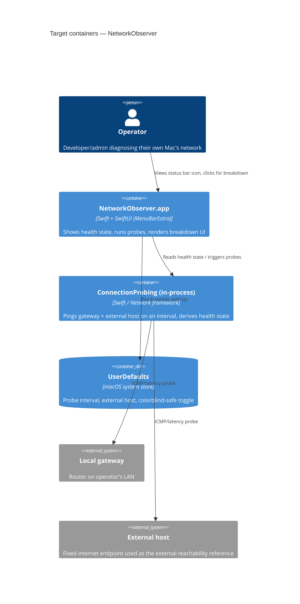

# Architecture map — NetworkObserver

> The **target foundation** for a greenfield macOS menu-bar app, fixed by `survey` and materialized
> by `scaffold`. The repo currently holds only Xcode's default SwiftUI+SwiftData document-app
> template (`NetworkObservation/ContentView.swift`, `Item.swift`) — unrelated to the product idea in
> `docs/idea-brief.md` and slated for removal during scaffolding.

## Stack

- Language / runtime: Swift 5 (`NetworkObservation.xcodeproj/project.pbxproj`: `SWIFT_VERSION = 5.0`)
- Frameworks: SwiftUI (`MenuBarExtra` scene for the menu-bar UI), Foundation for networking probes.
  SwiftData is dropped — no persisted record list in v1, only user settings.
- Build / test / lint: `xcodebuild build` / `xcodebuild test` (scheme `NetworkObservation`, existing
  `NetworkObservationTests` XCTest target). No linter installed (SwiftLint absent) — `lint_cmd` left
  empty by user choice; may be added later.
- Persistence: `UserDefaults` (via `@AppStorage`) for user-configurable settings (probe interval,
  external host) — no database, no migration tool.

## C4 — system as it is (target baseline)

## Module inventory

| Module | Path | Layers | Wired at | Responsibility |
|---|---|---|---|---|
| App | `NetworkObservation/App/` | entry point | `NetworkObservationApp.swift` | App entry, `MenuBarExtra` scene wiring |
| Features/ConnectionHealth | `NetworkObservation/Features/ConnectionHealth/` | Domain/Reducer/Store/View (MVI) | per-feature | Menu-bar health indicator + breakdown popover, per `.claude/skills/ios-MVI-architecture` |
| Core | `NetworkObservation/Core/` | services | injected into Stores | Probe execution (gateway + external host reachability/latency), settings persistence |
| Shared | `NetworkObservation/Shared/` | utilities | imported by Features | `Patch<T>` and other cross-feature MVI utilities per the MVI skill guide |

## Conventions (cited — the rules a new feature must match)

- **Architecture style:** MVI (Model → View → Intent) — namespace enum `<Feature>Domain` holding
  `State`/`Intent`/`Effect`/`Navigation`, a pure `Reducer`, an `@MainActor @Observable` `Store`, a
  dumb `View` — full contract in `.claude/skills/ios-MVI-architecture/SKILL.md`. Every new feature
  screen follows this pattern exactly (project-mandated, pre-existing skill file).
- **Module wiring / registration:** UseCases/services injected into a Store's `init` — never created
  inside the Store (`.claude/skills/ios-MVI-architecture/SKILL.md`, Store rules).
- **Error handling:** surfaced as `Intent._loadingFailed(Error)` → `State.errorMessage`, never thrown
  across the View boundary (same skill doc, Reducer/Intent examples).
- **IDs:** N/A — no persisted entities with IDs in v1.
- **Persistence / DB access:** `UserDefaults` via `@AppStorage`/a thin settings wrapper in `Core/` —
  no database.
- **Migrations:** none — no datastore to migrate (dropped explicitly, see scaffold plan below).
- **Tests:** XCTest, existing targets `NetworkObservationTests` (unit) and
  `NetworkObservationUITests` (UI) — reducers/use-cases are unit-tested with zero mocking per
  `.claude/skills/ios-tdd-workflow/SKILL.md` (strict red-green-refactor for new business logic).
- **Inter-module communication:** direct calls / dependency injection within one app target — no
  cross-process IPC in v1.
- **UI / styling:** SwiftUI native controls only, no third-party design system — `MenuBarExtra` is
  the entry surface; `Shared/` holds any reusable view helpers as they emerge.

## Datastores

| Store | Engine | Accessed via | Notes |
|---|---|---|---|
| Settings | `UserDefaults` (macOS) | `@AppStorage` / a `Core/` settings wrapper | Probe interval, external host, colorblind-safe toggle — no schema/migrations |

## Frontend / UI foundation

- **Component library / design system:** none yet — native SwiftUI controls; first components are
  created as part of the `connection-health` feature.
- **Design tokens:** none yet — system colors/SF Symbols until a token need emerges.
- **Styling approach:** SwiftUI view modifiers, no CSS-like styling layer (not applicable on macOS
  native).
- **Shared primitives:** none yet — `Shared/` is created empty by scaffold, ready for the first
  reusable view.
- **State / data-fetching:** MVI `Store` per feature (`@Observable`), no external state library.
- **Closest UI precedent:** none in-repo yet — `connection-health`'s menu-bar popover is the first
  screen and becomes the precedent for later ones.

## Where things live / closest precedents

- A new feature screen → `NetworkObservation/Features/<FeatureName>/`, modelled on the MVI skeleton
  in `.claude/skills/ios-MVI-architecture/SKILL.md` (no existing feature precedent yet —
  `connection-health` is the first).
- A new background/service capability (e.g. a new probe type) → `NetworkObservation/Core/`.

## Constraints & known tech-debt

- **Xcode template leftovers:** `NetworkObservation/ContentView.swift` and `Item.swift` are the
  default SwiftData document-app template, unrelated to this product — `scaffold` removes them.
- **Placeholder bundle identifier:** `PRODUCT_BUNDLE_IDENTIFIER` values in `project.pbxproj` still
  read `com.msg.groceriesTracker.*` (copy-paste leftover from a prior template) — needs correcting
  before distribution; not blocking for scaffold/dev builds.
- **Outside App Store distribution (decided in `docs/idea-brief.md`):** the diagnostic probes need
  permissions the sandbox restricts, so the app ships unsandboxed / notarized outside the App Store
  — affects entitlements and signing setup whenever `scaffold`/`implement` touch build settings.
- **No CI / lint configured:** by explicit choice for v1 (indie project, no App Store gate) — revisit
  if the team grows or distribution requirements change.
- **A nested duplicate directory `NetworkObserver/`** (with its own `.git`) exists at the repo root
  alongside the real project — apparently a stray/duplicated clone, left untouched here since its
  origin is unclear; flag to the repo owner.

## Reconciliation with the authored architecture doc

No authored `docs/architecture.md` exists. The root `CLAUDE.md` is generic behavioral guidance (not
architecture-specific) and is unaffected by this map. The `.claude/skills/ios-MVI-architecture/
SKILL.md` file **is** an authored, project-mandated architecture convention — it is treated as
authoritative and reflected above, not overridden.
