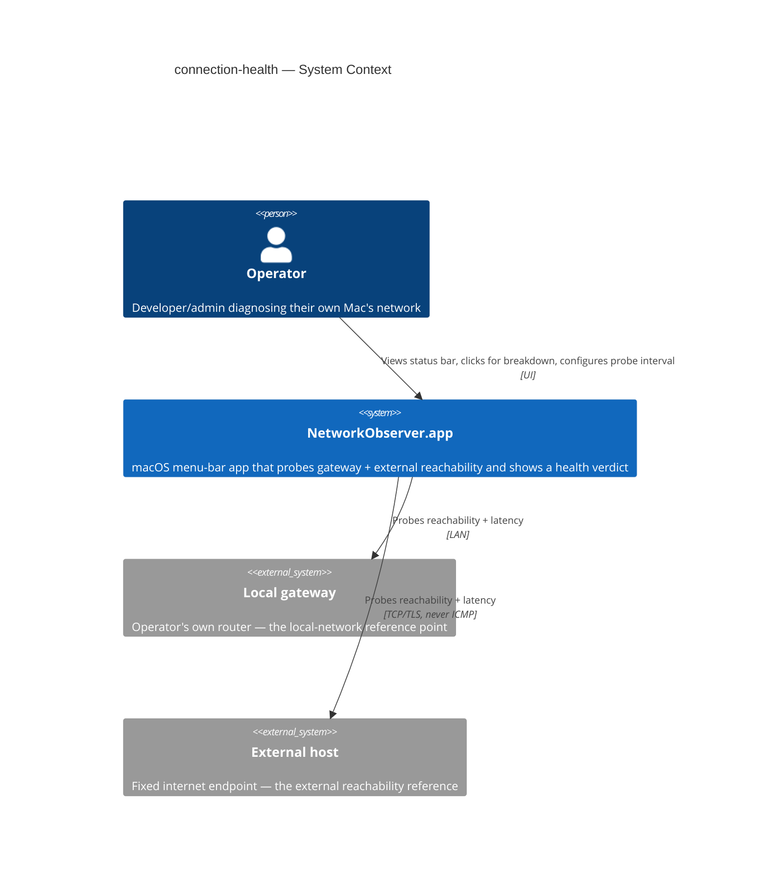

# Software Architecture Document — connection-health

## 1. Introduction and goals

**Intent.** connection-health gives operators (the developer/admin who installs and runs the
app on their own Mac to self-diagnose network problems — CONTEXT glossary) a glanceable,
color-coded menu-bar health indicator that distinguishes a local (gateway) problem from an
external (internet) problem, so they no longer need to open Activity Monitor or a terminal to
answer "is it my network or the internet." The indicator must be trustworthy enough (rare
false alarms) that operators leave it running continuously, and light enough that doing so
costs them nothing noticeable.

**Top-3 quality goals (1-liners; full scenarios in §10):**

1. **Accuracy** — false alarms are rare enough to trust a degraded/unreachable reading (spec
   §6: ≤ 1 false state transition into degraded/unreachable per 24h). This is the headline
   trust goal (spec §2).
2. **Resource efficiency** — negligible idle overhead so operators leave the app running at
   all times (spec §6: ≤ 1% CPU, ≤ 50 MB resident at the default probe interval).
3. **Responsiveness** — the status bar reflects reality fast enough to be useful mid-incident
   (spec §6: ≤ 250 ms status update latency; ≤ 3 probe intervals / ≤ 15 s detection latency).

**Stakeholders.**

| Role | Interest | Sign-off owner? |
|---|---|---|
| Operator (CONTEXT glossary) | Sole end user — reads the indicator daily to self-diagnose network problems | No |
| Tech Lead | SAD approval | Yes |
| Security Lead | Reviews the Local Network permission boundary and non-App-Store distribution posture (spec §6.1) | Yes |

<!-- Decision overrides (¶4) — populated by the critic resolution loop, empty otherwise. -->

## 2. Constraints

**Technical.**
- Swift 5 (`NetworkObservation.xcodeproj/project.pbxproj`: `SWIFT_VERSION = 5.0`)
- SwiftUI (`MenuBarExtra` scene) for the UI; Foundation + Network framework for the probes
- No datastore — settings only, persisted via `UserDefaults` (`@AppStorage`)
- Architecture convention: MVI (Model → View → Intent) per `.claude/skills/ios-MVI-architecture/SKILL.md` — mandatory for every feature screen, including this one
- Minimum supported macOS: current major release and the previous one (batch-approved assumption, spec §8) — no older API surface is targeted

**Organisational.**
- No fixed deadline or PR-count budget stated in the spec; sized M (1–2 sprints) per `.size`
- Single-developer/indie project (no team-composition constraint beyond the Architect/Tech Lead role)

**Conventions.**
- `.claude/skills/ios-MVI-architecture/SKILL.md` — Store/Reducer/View contract, dependency injection into `Store.init`, `Intent._loadingFailed(Error)` error surfacing
- `.claude/skills/ios-tdd-workflow/SKILL.md` — reducers/use-cases unit-tested with zero mocking
- No ID strategy — v1 has no persisted entities with IDs

**Regulatory / external.**
- No data leaves the device (spec §6.1) — no compliance regime applies
- Non-App-Store distribution is a fixed constraint carried from `docs/idea-brief.md` (unsandboxed, notarized) — see §4 for the confirming decision and its ADR

## 3. Context and scope

connection-health is a self-contained macOS menu-bar app. It has one human actor (the
operator) and two external network endpoints it measures against, but talks to no external
service, backend, or identity provider — everything the app knows about the world comes from
its own two probes.

<!-- brownfield: N/A — greenfield repo. The repo currently holds only Xcode's default
     SwiftUI+SwiftData document-app template (architecture-map.md, mode: greenfield-bootstrap);
     no source has changed since that map was produced (`git diff 3f72b32..HEAD` touches no
     source file), so the map is read as current, not re-scanned. -->

**External systems (in / out):**

| Actor or system | Type | Interaction |
|---|---|---|
| Operator | Person | Views the status-bar indicator; clicks it for the gateway/external breakdown; adjusts the probe interval in settings; grants or denies the OS Local Network permission prompt |
| Local gateway | System (external — operator's own router) | Receives a periodic reachability/latency probe; not owned or controlled by this app |
| External host | System (external — fixed internet reference point) | Receives a periodic reachability/latency probe over a TCP/HTTPS-based check (never ICMP, spec §6.1); the exact host is fixed, not user-editable (spec §6.1 abuse cases) |
| macOS (Local Network permission) | System (external — OS boundary) | Gates whether either probe can run at all; the app must request access explicitly and handle denial (AC-03/AC-03b) |

**C4 Context (L1):**

The diagram shows the operator and the app as the only internal parties — no other person or
service is in scope — and two external systems the app measures but does not control: the
local gateway (reached over the LAN) and a fixed external host (reached over a TCP/TLS-based
check, never ICMP, per spec §6.1 — the exact probing mechanism per target is a §4 decision).
The OS Local Network permission boundary sits between the app and both probes and is modeled
as a crosscutting concept in §8, not a fourth C4 element, since it's a gate on existing
relationships rather than a party the app talks to.

