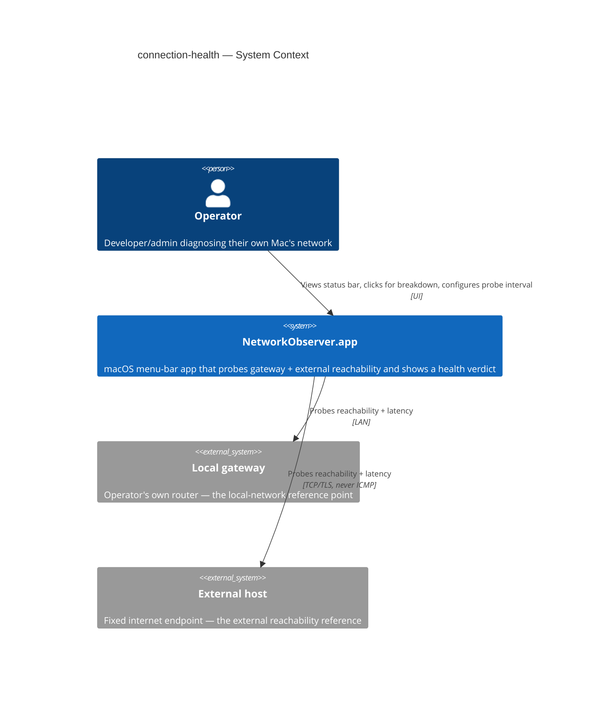
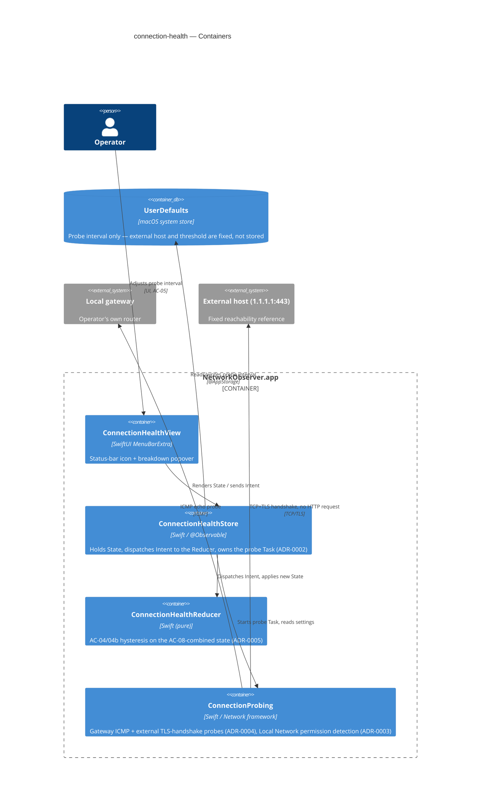
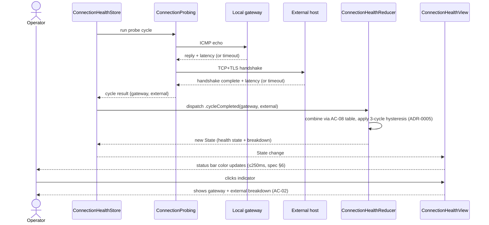
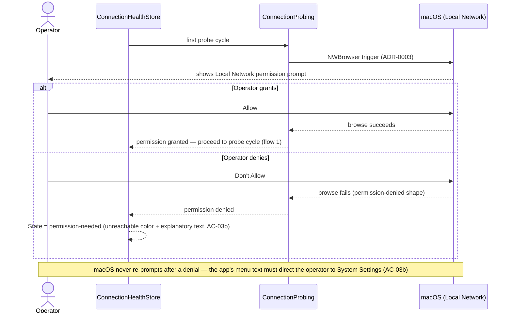

# Software Architecture Document — connection-health

## 1. Introduction and goals

**Intent.** connection-health gives operators (the developer/admin who installs and runs the
app on their own Mac to self-diagnose network problems — CONTEXT glossary) a glanceable,
color-coded menu-bar health indicator that distinguishes a local (gateway) problem from an
external (internet) problem, so they no longer need to open Activity Monitor or a terminal to
answer "is it my network or the internet." The indicator must be trustworthy enough (rare
false alarms) that operators leave it running continuously, and light enough that doing so
costs them nothing noticeable.

**Top-3 quality goals (1-liners; full scenarios in §10):**

1. **Accuracy** — false alarms are rare enough to trust a degraded/unreachable reading (spec
   §6: ≤ 1 false state transition into degraded/unreachable per 24h). This is the headline
   trust goal (spec §2).
2. **Resource efficiency** — negligible idle overhead so operators leave the app running at
   all times (spec §6: ≤ 1% CPU, ≤ 50 MB resident at the default probe interval).
3. **Responsiveness** — the status bar reflects reality fast enough to be useful mid-incident
   (spec §6: ≤ 250 ms status update latency; ≤ 3 probe intervals / ≤ 15 s detection latency).

**Stakeholders.**

| Role | Interest | Sign-off owner? |
|---|---|---|
| Operator (CONTEXT glossary) | Sole end user — reads the indicator daily to self-diagnose network problems | No |
| Tech Lead | SAD approval | Yes |
| Security Lead | Reviews the Local Network permission boundary and non-App-Store distribution posture (spec §6.1) | Yes |

<!-- Decision overrides (¶4) — populated by the critic resolution loop, empty otherwise. -->

## 2. Constraints

**Technical.**
- Swift 5 (`NetworkObservation.xcodeproj/project.pbxproj`: `SWIFT_VERSION = 5.0`)
- SwiftUI (`MenuBarExtra` scene) for the UI; Foundation + Network framework for the probes
- No datastore — settings only, persisted via `UserDefaults` (`@AppStorage`)
- Architecture convention: MVI (Model → View → Intent) per `.claude/skills/ios-MVI-architecture/SKILL.md` — mandatory for every feature screen, including this one
- Minimum supported macOS: current major release and the previous one (batch-approved assumption, spec §8) — no older API surface is targeted

**Organisational.**
- No fixed deadline or PR-count budget stated in the spec; sized M (1–2 sprints) per `.size`
- Single-developer/indie project (no team-composition constraint beyond the Architect/Tech Lead role)

**Conventions.**
- `.claude/skills/ios-MVI-architecture/SKILL.md` — Store/Reducer/View contract, dependency injection into `Store.init`, `Intent._loadingFailed(Error)` error surfacing
- `.claude/skills/ios-tdd-workflow/SKILL.md` — reducers/use-cases unit-tested with zero mocking
- No ID strategy — v1 has no persisted entities with IDs

**Regulatory / external.**
- No data leaves the device (spec §6.1) — no compliance regime applies
- Non-App-Store distribution is a fixed constraint carried from `docs/idea-brief.md` (unsandboxed, notarized) — see §4 for the confirming decision and its ADR

## 3. Context and scope

connection-health is a self-contained macOS menu-bar app. It has one human actor (the
operator) and two external network endpoints it measures against, but talks to no external
service, backend, or identity provider — everything the app knows about the world comes from
its own two probes.

<!-- brownfield: N/A — greenfield repo. The repo currently holds only Xcode's default
     SwiftUI+SwiftData document-app template (architecture-map.md, mode: greenfield-bootstrap);
     no source has changed since that map was produced (`git diff 3f72b32..HEAD` touches no
     source file), so the map is read as current, not re-scanned. -->

**External systems (in / out):**

| Actor or system | Type | Interaction |
|---|---|---|
| Operator | Person | Views the status-bar indicator; clicks it for the gateway/external breakdown; adjusts the probe interval in settings; grants or denies the OS Local Network permission prompt |
| Local gateway | System (external — operator's own router) | Receives a periodic reachability/latency probe; not owned or controlled by this app |
| External host | System (external — fixed internet reference point) | Receives a periodic reachability/latency probe over a TCP/HTTPS-based check (never ICMP, spec §6.1); the exact host is fixed, not user-editable (spec §6.1 abuse cases) |
| macOS (Local Network permission) | System (external — OS boundary) | Gates whether either probe can run at all; the app must request access explicitly and handle denial (AC-03/AC-03b) |

**C4 Context (L1):**



The diagram shows the operator and the app as the only internal parties — no other person or
service is in scope — and two external systems the app measures but does not control: the
local gateway (reached over the LAN) and a fixed external host (reached over a TCP/TLS-based
check, never ICMP, per spec §6.1 — the exact probing mechanism per target is a §4 decision).
The OS Local Network permission boundary sits between the app and both probes and is modeled
as a crosscutting concept in §8, not a fourth C4 element, since it's a gate on existing
relationships rather than a party the app talks to.

## 4. Solution strategy

**Target surface — `desktop-app` (decided, no ADR: single obvious option).** The feature is a
single macOS menu-bar application; there is no backend service, web frontend, or any other
deployable — every probe, every piece of state, and the UI itself run in one process. No
alternative surface was realistic given spec §1's "minimal macOS menu-bar app," so this doesn't
cross the blast-radius gate (no legitimate alternative).

**UI-architecture — native SwiftUI `MenuBarExtra` (decided, no ADR: excluded by an existing
constraint).** `architecture-map.md` already fixes SwiftUI + `MenuBarExtra` as the project's
convention for this surface, and no cross-platform or alternative UI toolkit was ever in play —
the "has legitimate alternative" gate criterion is not met.

**Top strategic choices (the ADR seeds):**

1. **Ship unsandboxed outside the App Store** — the headline diagnostic feature needs
   raw/ICMP-style network access the App Sandbox restricts. → **ADR-0001**.
2. **Structured-concurrency `Task` loop for probe scheduling** — a `while` loop over
   `Task.sleep(interval)`, cancelled via SwiftUI's `.task {}` lifecycle, feeding results to the
   Store as they complete. → **ADR-0002**.
3. **Detect Local Network permission via a short-lived `NWBrowser` trigger** — since macOS has
   no direct "query current grant" API, a Bonjour browse at first-probe time both triggers the
   OS prompt and is read as the permission signal, kept separate from the real gateway probe so
   "no permission" and "gateway down" never conflate. → **ADR-0003**.
4. **ICMP for the gateway probe, a bare TCP/TLS handshake for the external probe** — each target
   gets the most reliable primitive for its own network context; the external probe stays
   TCP/HTTPS-based per spec §6.1 and never touches ICMP. → **ADR-0004**.
5. **Hysteresis on the AC-08-combined state, computed in the Reducer** — the 3-consecutive-cycle
   rule (AC-04/AC-04b) is applied once, to the already-combined per-cycle candidate, as pure
   Reducer logic. → **ADR-0005**.

**Other decisions (config-level, no ADR — low cost to change later):**

- **External-host probe target: the fixed IP `1.1.1.1:443`** (Cloudflare's anycast address).
  The probe is a bare TCP+TLS handshake, no HTTP request — this sidesteps DNS-resolution timing
  and any dependency on the target's HTTP response body. The host is not user-editable (spec
  §6.1 abuse cases) and swapping it later is a one-line config change, not a rework.
- **Gateway degraded-latency threshold (AC-06): 100 ms.** Typical healthy Wi-Fi/LAN latency to
  a home gateway is tens of milliseconds; 100 ms is a clear signal of local congestion without
  being so tight that ordinary Wi-Fi jitter trips it. A fixed absolute value, not adaptive, per
  spec §8's resolution. A plain config constant — changing it later is a one-line edit, not a
  rework.
- **Persistence: `UserDefaults` via `@AppStorage`** — already fixed in `architecture-map.md`;
  carried forward, not re-decided.

Every tactical decision in §5–§8 traces to one of the five strategic choices above; none
contradicts them.

## 5. Building block view

Single deployable, layered per the project's MVI convention (`.claude/skills/ios-MVI-architecture/SKILL.md`):
a dumb SwiftUI `View` renders `State`, an `@Observable` `Store` holds `State` and dispatches
`Intent`s to a pure `Reducer`, and `Core` services (injected into the Store's `init`, never
created inside it) do the actual I/O. No new module boundary is introduced beyond what
`architecture-map.md` already scaffolds — this feature is the first to fill in
`Features/ConnectionHealth` and `Core`.

**Internal decomposition:**

```
NetworkObservation/
├── App/
│   └── NetworkObservationApp.swift        <MenuBarExtra scene wiring>
├── Features/ConnectionHealth/
│   ├── ConnectionHealthDomain.swift       <State / Intent / Effect / Navigation enum>
│   ├── ConnectionHealthReducer.swift      <pure reducer — AC-04/04b/06/08 hysteresis + mapping, ADR-0005>
│   ├── ConnectionHealthStore.swift        <@MainActor @Observable Store — owns the probe Task, ADR-0002>
│   └── ConnectionHealthView.swift         <status-bar icon + click-through breakdown popover>
├── Core/
│   ├── ConnectionProbing/
│   │   ├── GatewayProbe.swift             <ICMP ping-socket, ADR-0004>
│   │   ├── ExternalHostProbe.swift        <TCP/TLS handshake to 1.1.1.1:443, ADR-0004>
│   │   └── LocalNetworkPermission.swift   <NWBrowser trigger + denial detection, ADR-0003>
│   └── Settings/
│       └── ConnectionHealthSettings.swift <probe interval via @AppStorage>
└── Shared/                                 <empty until a second feature needs it>
```

**C4 Container (L2):**



The container view shows one process split into four internal containers per the MVI
convention: the `View` only renders and forwards intents; the `Store` owns the running probe
loop and holds state; the `Reducer` is pure business logic (hysteresis, AC-08 combination); and
`ConnectionProbing` is where all I/O — both probes and the permission check — actually happens.
`UserDefaults` stores only the probe interval, since the external host and the gateway threshold
are fixed constants (§4), not user-editable settings (spec §6.1). The two external systems are
reached only from `ConnectionProbing`, matching §3's context boundary — no other container talks
to the network directly.

## 6. Runtime view

**Critical flow 1: probe cycle → health state update (AC-01, AC-02, AC-06, AC-08)**



**Critical flow 2: Local Network permission request and denial (AC-03, AC-03b)**



Flow 1 is the steady-state cycle: the Store triggers both probes, the Reducer combines their raw
results through the AC-08 table and the ADR-0005 hysteresis, and the resulting state reaches the
status bar within the ≤250ms NFR; a click reveals the gateway/external breakdown separately
(AC-02). Flow 2 covers the first-run and denial paths: an `NWBrowser` trigger (ADR-0003) is what
actually raises the OS prompt, and its outcome — not a direct query, since none exists — is
read as granted or denied; a denial locks the app into the permission-needed state described in
AC-03b, since macOS won't prompt a second time.

## 7. Deployment view

There is no server-side topology to scale — the entire system is one signed, notarized `.app`
bundle running on the operator's own Mac (ADR-0001: unsandboxed, outside the App Store).
Distribution is a `.dmg` or `.zip` download; there are no replicas, no load balancing, and no
multi-instance concerns, since each install is a single process on a single machine serving one
operator. The only "scaling" axis is the probe interval itself (spec US-03, AC-05), which the
operator controls directly.

**Monitoring:**
- No remote telemetry (spec §6.1: no data leaves the device) — all NFR verification (spec §6)
  happens via local instrumentation and Activity-Monitor soak tests during development, not a
  production monitoring stack.
- Crash-free-session tracking (spec §6: ≥99%) is measured from local soak-test logs, not a
  crash-reporting service — none is in scope for v1.

**Scaling thresholds:** N/A — a single-user, single-process local app has no request volume or
data-growth axis to plan around.

<!-- Distribution mechanics (signing identity, notarization pipeline, entitlements file) are a
     build/CI concern for the `tasks`/`implement` stages, not an architecture decision — this
     section records the topology, not the release pipeline. -->


