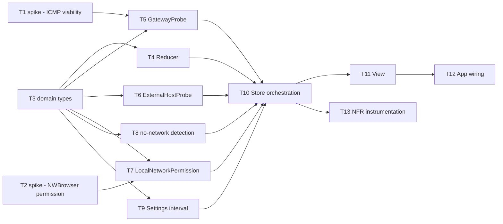

# Epic — connection-health

> **Spec:** [spec.md](../spec.md) · **Design:** [sad.md](../sad.md) · **Data model:** [data-model.md](../data-model.md) (no schema change) · **ADRs:** [adr/](../adr/)

## Goal

Ship the menu-bar health indicator that tells an operator at a glance whether their connection
is fine, and on click whether a problem is local (gateway) or external (internet) — the two
probes, the combination + hysteresis logic, the permission flow, and the status-bar UI (spec §2).

## Scope

- **In:** `Features/ConnectionHealth/` (domain types, reducer, store, view), `Core/ConnectionProbing/`
  (gateway probe, external probe, permission detection, no-network detection), `Core/Settings/`
  (probe interval), the `App/` composition root, and the two upstream spikes (ADR-0003/ADR-0004
  unverified assumptions) that gate them.
- **Out:** per-app traffic breakdown, packet capture, historical graphs, push notifications, a
  second external host, VPN/multi-homed correctness, in-app update checking (spec §3 Non-goals).

## Task map

## Tasks

See [tracker.md](./tracker.md) for status. Machine contract: [tasks.json](../tasks.json).

| # | Task | Layer | Blocked by | DoD (short) |
|---|---|---|---|---|
| T1 | Spike: ICMP ping-socket viability | infra | — | ADR-0004 assumption confirmed or fallback recorded |
| T2 | Spike: NWBrowser permission trigger | infra | — | ADR-0003 assumption confirmed or fallback recorded |
| T3 | Domain types (State/Intent/Effect) | domain | — | State/probe-result enums unit-tested |
| T4 | Reducer (AC-08 + hysteresis) | domain | T3 | 9-combination table + AC-04/AC-04b hysteresis tested |
| T5 | GatewayProbe (ICMP) | infra | T1, T3 | reachability+latency or timeout, tested |
| T6 | ExternalHostProbe (TCP/TLS) | infra | T3 | handshake-only reachability+latency, tested |
| T7 | LocalNetworkPermission | infra | T2, T3 | granted/denied signal distinct from timeout |
| T8 | No-network detection | infra | T3 | signal distinct from a probe timeout |
| T9 | Settings (probe interval) | infra | T3 | min-interval validation tested |
| T10 | Store orchestration | app | T4–T9 | probe loop + sleep/wake tested |
| T11 | View (status bar + popover) | ui | T10 | all 5 states render distinctly, breakdown shown |
| T12 | App wiring | wiring | T11 | app builds, icon appears on smoke run |
| T13 | NFR instrumentation | tests | T10 | one log line per cycle + per transition |

## Risks / Hard rules

- ADR-0003 and ADR-0004 each carry an unverified assumption (sad §11, High severity) — T1/T2
  retire them before T5/T7 build the real mechanism on top.
- The Reducer must stay a pure function, zero-mocked in tests (`.claude/skills/ios-tdd-workflow/SKILL.md`).
- No data leaves the device (spec §6.1) — T13's instrumentation is local `os_log` only, never a
  remote telemetry call.
- The enforced minimum probe interval (AC-05, spec §6.1 abuse cases) must never be bypassable
  from anywhere other than the Store's own validation path.
